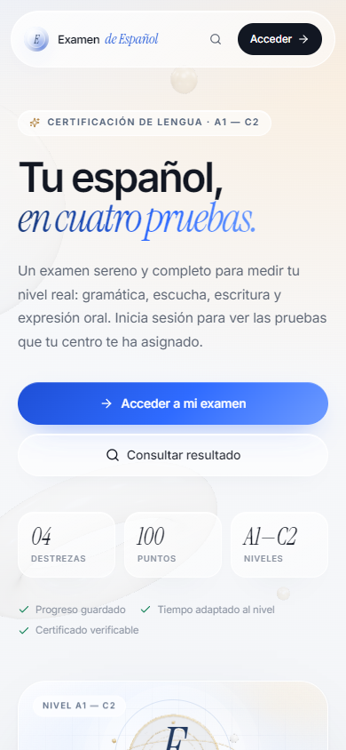
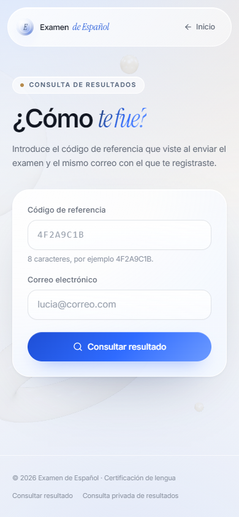
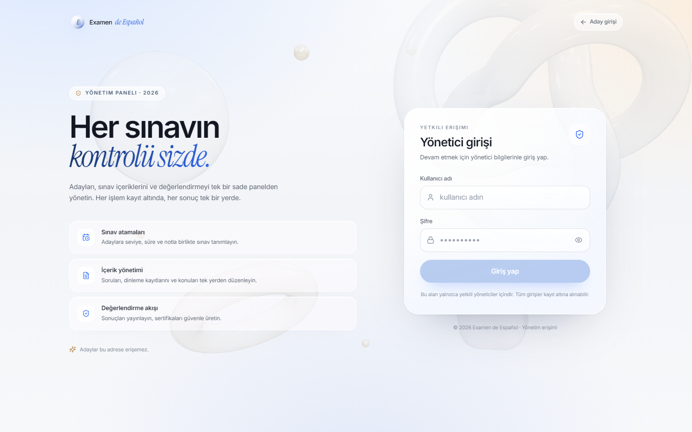

<div align="center">

# Examen de Español

**A complete Spanish proficiency exam platform for language schools and independent exam centres.**

Candidates receive personal exam assignments, complete a four-skill assessment in a calm, distraction-free interface, and receive transparent results and verifiable participation documents. Administrators manage content, scheduling, grading and publication from a dedicated console.

[Live site](https://erdalbirinci.github.io/examen-espanol/) · [Admin console](https://erdalbirinci.github.io/examen-espanol/adminpanel) · [Supabase schema](supabase/schema.sql)


</div>

## Overview

Examen de Español is a static React single-page application backed by Supabase. It is designed for a real assessment workflow rather than a demo quiz: candidates only see exams assigned to their email address, every submission is validated on the server, correct answers never reach the browser, and results stay hidden until an administrator publishes them.

The candidate experience is in Spanish. The administration console is in Turkish, matching the workflow of the exam centre that operates it.

### At a glance

- Six CEFR levels: **A1, A2, B1, B2, C1 and C2**.
- Four independently scored skills: **vocabulary and grammar, listening, writing and speaking**, worth **50 + 10 + 20 + 20 = 100** points.
- Assignment-based access with per-exam result visibility and no time limit for the candidate.
- Server-side submission, duplicate-submission protection and automatic scoring.
- Resumable exams through a server-side draft.
- Result lookup by reference code and email.
- A verifiable **constancia de participación** for every published, graded result. It records attendance only and does not certify a level of competence.
- Responsive, premium UI with optional WebGL backgrounds and reduced-motion support.

## Screenshots

All screenshots below are from the live GitHub Pages deployment.


*The candidate landing page: exam overview, 3D medallion and the candidate sign-in panel.*

| Mobile candidate landing | Mobile result lookup |
| :---: | :---: |
|  |  |



*The administrator sign-in screen. Administrators manage assignments, content, grading and participation documents from the console.*

## Features

### Candidate experience

- **Open registration.** Anyone can create an account with a name, e-mail and password; the centre assigns exams to that e-mail afterwards.
- **Personal dashboard.** Candidates see only their own assignments, with level, note and current status.
- **Flexible section order.** Candidates can move between the four sections freely; answers are preserved per section.
- **Autosave and resume.** A server-side draft is written while the exam is in progress. The same browser resumes automatically; another device can continue with the draft code and email.
- **No time limit.** An assignment has no due date or duration; the candidate starts and submits the exam whenever they are ready.
- **Pre-submit review.** A summary shows which sections are complete and which are still missing before final submission.
- **Result lookup.** A reference code and email are enough to retrieve the candidate's own result summary.
- **Downloadable report.** A graded result can be saved as an A4 PDF with the section-by-section breakdown (test, listening, writing part 1 and 2, speaking part 1 and 2).
- **Participation document.** Every graded candidate whose result is published can download a PDF or PNG *constancia de participación* and share a public verification link.

### Exam integrity

- Correct answers are stored in the private `questions` table. Candidates read only the `questions_public` view, which excludes `correct_index` and explanations.
- Submission goes through the `submit_attempt` database function, not a direct table insert.
- The server validates the assignment ID, candidate email, level, answer shapes and file paths before accepting a submission.
- One assignment can produce only one attempt (`attempts.assignment_id` is unique).
- A two-minute rate limit prevents accidental duplicate submissions from the same email.
- Test and listening scoring runs in Postgres. Writing and speaking points are entered by an administrator and the total is recalculated server-side.
- Result fields are hidden by server functions until the assignment's results are published.

### Practice mode

`/deneme` offers an open, unscored practice test: ten random questions for the chosen level, instant feedback with the correct option, and no attempt record. Answers are checked by the `practice_check` database function, which only reveals keys for the questions the visitor actually answered.

### Grading workflow

- **Rubrics.** Each writing part and each speaking part can be scored criterion by criterion (0–5 each). The database rejects a rubric whose total does not match the section score, so stored points always have a traceable breakdown.
- **Queue.** “Sıradaki bekleyen” opens the oldest ungraded attempt and “Kaydet ve sıradakine geç” moves straight to the next one.
- **Review aids.** Speaking recordings play at 0.75×–1.5× speed, and the signalled integrity counters (tab switches, paste attempts) are shown next to the answers.
- **Audit trail.** Every submission and every change to points, note, rubric or status is appended to `grading_audit` with the administrator's email; the attempt detail lists the last 50 entries.
- **Question history.** Each create, update and delete of a test question stores a snapshot in `question_revisions`, visible from the edit dialog.
- **Bulk operations.** Assignments can be created for a list of e-mails at once and published or hidden in bulk from the selection toolbar.
- **CSV export.** The results list exports every row matching the current filters (up to 5,000) with all section points.
- **Client errors.** Uncaught errors and unhandled rejections are stored in `client_errors` (at most ten per tab) for later inspection in the SQL editor.

### Administration

The admin console covers the complete exam lifecycle:

| Section | What it does |
| --- | --- |
| **Overview** | Exam volume, monthly activity, pending grading, average test score, level distribution, content completeness matrix and JSON backup |
| **Users** | Registered candidate accounts with lifecycle detail, date-range and activity-type filters, assignment/submission/draft history, account disable and re-enable, password reset, session revocation and full account deletion |
| **Candidate exams** | Create assignments for one or many e-mails (level, title, note, result visibility), then publish or hide results in bulk |
| **Exam results** | Review test answers, listening answers, both writing parts and the part 1 speaking recording; the listening score is calculated from the keyed answers, writing (0–10 + 0–10) and speaking (0–10 + 0–10) are scored by the administrator with optional rubrics; a grading queue, audit trail and CSV export are built in; publish results and trigger result emails |
| **Test questions** | Level-scoped multiple-choice CRUD with four options, correct answer and ordering |
| **Answer key** | One-page answer key per level with the correct option, answer text and grading note; printable and downloadable as CSV |
| **Listening** | Upload audio (up to 50 MB), title, play limit and ordering, then key the multiple-choice questions for each recording |
| **Writing** | Two prompts per level (part 1 and part 2), each with a minimum word count |
| **Speaking** | Two parts per level: part 1 is recorded by the candidate, part 2 shows a photograph and is assessed live by the examiner; each part has its own prompt, guidance, preparation and speaking times |

Admin routes require a Supabase session whose profile has `role = 'admin'`. All data access is additionally protected by row-level security.

### Content import and export

**Test questions → Bulk import** accepts CSV or JSON, either as an uploaded file or pasted text. A preview lists valid, invalid and already-existing questions before anything is written. Only valid rows are inserted and duplicate prompt text is skipped.

**Download CSV** exports all questions for the selected level in the same column layout, encoded as UTF-8 with a BOM for Excel compatibility. The file can be edited and re-imported; existing prompts are skipped.

CSV header:

```csv
prompt,option_a,option_b,option_c,option_d,correct,explanation,position
"¿Cómo ___?",te llamas,te llama,se llamas,llamas,A,,1
```

JSON format:

```json
[
  {
    "prompt": "¿Cómo ___?",
    "options": ["te llamas", "te llama", "se llamas", "llamas"],
    "correct": "A",
    "explanation": "Saludo básico",
    "position": 1
  }
]
```

`correct` accepts a letter from A to F or a number from 1 to 6. In JSON, `correct_index` is zero-based. If `position` is omitted, the question is appended after the existing questions. At least two options are required, and rows with empty options are rejected.

## Architecture

| Layer | Technology |
| --- | --- |
| Frontend | React 19, TypeScript, Vite 6, React Router 7, Tailwind CSS 4, lucide-react |
| 3D and motion | Three.js, lazy-loaded WebGL scenes, CSS animations, `prefers-reduced-motion` support |
| Hosting | GitHub Pages, built by GitHub Actions, static SPA with a `404.html` fallback |
| Database and auth | Supabase Postgres with row-level security, Supabase Auth |
| File storage | Supabase Storage: public `exam-media` audio, private `exam-recordings` recordings |
| Scoring | Postgres functions and triggers (`submit_attempt`, `score_attempt`, `issue_certificate`, `get_certificate`) |
| Optional email | Supabase Edge Function `notify-result` using Resend |

### Data flow

1. The candidate creates an account with a name, e-mail and password. No assignment is needed at that point.
2. An administrator creates listening, writing and speaking content and assigns an exam to the candidate e-mail; the exam then appears in the candidate's panel.
3. The candidate signs in, opens the assigned exam and receives a server-backed draft.
4. Answers are saved to the draft as the candidate works, with no time limit.
5. Final submission validates the assignment and writes a locked attempt. Test and listening answers are scored immediately (1 point per question); both writing parts and both speaking parts wait for manual grading.
6. The administrator reviews the attempt, enters section scores and publishes the result when ready.
7. The candidate can look up the result and download a participation document with a public verification code.

## Exam structure and scoring

| Section | Candidate task | Points |
| --- | --- | --- |
| **Vocabulario y Gramática** | 50 multiple-choice questions drawn at random from the level pool | 50 (1 per question) |
| **Comprensión Auditiva** | Listen up to the allowed number of plays and answer keyed multiple-choice questions | 10 (1 per question) |
| **Expresión Escrita** | Write two compositions, part 1 and part 2 | 20 (10 per part) |
| **Expresión oral** | Record an answer or upload an audio file | 20 |

The total is the sum of the four sections out of 100. Test and listening answers are scored by the database the moment the attempt is submitted; writing and speaking are entered by an administrator. Listening answers are keyed by the administrator on the listening page before the exam is taken, and the correct option is stored in the private table, so it never reaches the candidate.

The random question set is fixed for each draft: the 50 question IDs and the listening item are chosen once when the exam starts and stored on the draft, so a resume or refresh shows the same questions. Attempts created before this model keep their original 40/20/20/20 weighting and are still displayed correctly (`scoring_version`).

### Timing

Assignments carry no due date and no duration. The candidate can start, leave and resume an exam at any time and decides when to submit it; only a completed submission is final.

### Participation document

The centre does not certify language competence, so candidates receive a *constancia de participación* instead of a certificate. The document states that the candidate sat the Examen de Español at a given level and date; it does not show the score and carries no level or grade claim.

It is issued when the attempt has been graded and the result is published to the candidate. There is no score threshold.

The document code is random and does not expose the candidate's email. `/certificado/<code>` is the public verification page; it returns only the document fields through the `get_certificate` function, and no longer exposes the score. Documents can be downloaded as PDF or PNG, copied as a link, or shared to LinkedIn, X, WhatsApp and Facebook.

The database functions keep their original names (`issue_certificate`, `get_certificate`, `attempts.certificate_code`) so previously shared verification links and issued codes continue to work.

## Getting started

### Prerequisites

- **Node.js 22 LTS** and npm
- A [Supabase](https://supabase.com) project
- A GitHub repository with Pages enabled (for deployment)

### 1. Clone and install

```bash
git clone https://github.com/ErdalBirinci/examen-espanol.git
cd examen-espanol
npm install
```

### 2. Configure the frontend

```bash
cp .env.example .env
```

Set the public Supabase values:

```env
VITE_SUPABASE_URL=https://your-project.supabase.co
VITE_SUPABASE_ANON_KEY=your-anon-public-key
```

The anon key is designed to be public and is constrained by RLS. **Never put a `service_role` key in the frontend, `.env` or this repository.**

### 3. Set up Supabase

1. Create a free project at [supabase.com](https://supabase.com).
2. Open **SQL Editor** and run the complete contents of [`supabase/schema.sql`](supabase/schema.sql).
3. Apply the migrations in filename order:
   - [`20261023_exam_integrity.sql`](supabase/migrations/20261023_exam_integrity.sql)
   - [`20261024_result_lookup.sql`](supabase/migrations/20261024_result_lookup.sql)
   - [`20261025_exam_drafts.sql`](supabase/migrations/20261025_exam_drafts.sql)
   - [`20261026_result_email.sql`](supabase/migrations/20261026_result_email.sql)
   - [`20261027_membership.sql`](supabase/migrations/20261027_membership.sql)
   - [`20261028_assignment_settings.sql`](supabase/migrations/20261028_assignment_settings.sql)
   - [`20261029_certificates.sql`](supabase/migrations/20261029_certificates.sql)
   - [`20261030_candidate_admin.sql`](supabase/migrations/20261030_candidate_admin.sql)
   - [`20261031_candidate_activity_filters.sql`](supabase/migrations/20261031_candidate_activity_filters.sql)
   - [`20261101_scoring_v2.sql`](supabase/migrations/20261101_scoring_v2.sql)
   - [`20261102_admin_candidate_scores.sql`](supabase/migrations/20261102_admin_candidate_scores.sql)
   - [`20261103_participation_certificate.sql`](supabase/migrations/20261103_participation_certificate.sql)
   - [`20261104_exam_ops.sql`](supabase/migrations/20261104_exam_ops.sql)
   - [`20261105_security_hardening.sql`](supabase/migrations/20261105_security_hardening.sql)
   - [`20261106_storage_hardening.sql`](supabase/migrations/20261106_storage_hardening.sql)
   - [`20261107_b1_exam_and_speaking_parts.sql`](supabase/migrations/20261107_b1_exam_and_speaking_parts.sql)
   - [`20261108_result_speaking_parts.sql`](supabase/migrations/20261108_result_speaking_parts.sql)
   - [`20261109_open_registration.sql`](supabase/migrations/20261109_open_registration.sql)
   - [`20261110_legacy_email_check_stub.sql`](supabase/migrations/20261110_legacy_email_check_stub.sql) — constant stub so frontends built before open registration keep working; it can be dropped once the current build is deployed.
   - [`20261111_listening_order.sql`](supabase/migrations/20261111_listening_order.sql) — listening questions keep the administrator's `position` order in the draft and in the exam bundle.
   - [`20261112_assign_without_schedule.sql`](supabase/migrations/20261112_assign_without_schedule.sql) — assignments go through the `admin_assign_exams` function (fixes the RLS insert error) and no longer carry a due date or duration.

   The migrations are idempotent and safe to run again. After applying them, run `npm run verify:db` (reads only the public anon key). It checks the RPCs, audit tables and rubric columns, and also probes the public security surface: practice-mode answer keys, anonymous writes to `attempts`, draft ownership, admin RPC permissions, table RLS and storage bucket access.
4. Create the administrator account in **Authentication → Users → Add user**:
   - Email: `<username>@examen.local` (for example `yonetici@examen.local`)
   - Password: a strong password of your choice
   - Enable **Auto Confirm User**
5. Uncomment the `insert into public.profiles ...` block at the end of `schema.sql`, replace the email, and run it. This links the auth user to the `admin` role. Example:

   ```sql
   insert into public.profiles (id, username, display_name, role)
   select id, 'yonetici', 'Yönetici', 'admin'
   from auth.users
   where email = 'yonetici@examen.local'
   on conflict (id) do update
     set username = excluded.username, role = 'admin';
   ```

6. Optional: run [`supabase/seed.sql`](supabase/seed.sql) to insert 10 sample questions and one writing/speaking prompt per level. Listening audio still needs to be uploaded from the admin console.
7. Copy **Project URL** and the **anon public** key from **Project Settings → API** into `.env`.

> The admin login maps the username to `<username>@examen.local`. The password is never stored in the repository.

### 4. Run locally

```bash
npm run dev
```

Open `http://localhost:5173`.

### Frontend environment variables

| Variable | Required | Purpose |
| --- | --- | --- |
| `VITE_SUPABASE_URL` | Yes | Supabase project URL |
| `VITE_SUPABASE_ANON_KEY` | Yes | Public anon/publishable key used by the browser client |
| `VITE_BASE_PATH` | Deployment only | Vite base path; set automatically to `/<repository>/` by the Pages workflow |

Local development uses `/` as the base path. The production workflow sets `VITE_BASE_PATH` so assets resolve under the repository subpath.

## Deployment

The app is deployed as a static site to GitHub Pages.

1. Push the repository to GitHub with `main` as the default branch.
2. Open **Settings → Secrets and variables → Actions → Variables** and add:
   - `VITE_SUPABASE_URL`
   - `VITE_SUPABASE_ANON_KEY`
3. Open **Settings → Pages → Build and deployment** and select **GitHub Actions** as the source.
4. Push to `main`, or run `.github/workflows/deploy.yml` manually with **Run workflow**.

The workflow:

- installs dependencies with `npm ci`;
- builds with Node 22 and the repository's base path;
- runs `scripts/postbuild.mjs`, which copies `dist/index.html` to `dist/404.html` and writes `.nojekyll`;
- uploads the artifact and deploys it with `actions/deploy-pages`.

The `404.html` fallback is required because GitHub Pages has no server-side rewrites. It lets deep links such as `/adminpanel`, `/examen/<id>` and `/certificado/<code>` boot the SPA at the requested URL.

| Environment | URL |
| --- | --- |
| Candidate app | `https://<user>.github.io/<repository>/` |
| Admin console | `https://<user>.github.io/<repository>/adminpanel` |
| Result lookup | `https://<user>.github.io/<repository>/resultado` |

## Authentication and security

- Candidate accounts use Supabase Auth email/password. Registration is open; the account is only useful once an administrator assigns an exam to its e-mail, and it sees nothing else.
- Admin authentication uses a username converted to `<username>@examen.local`. Access is checked against `profiles.role = 'admin'` in the UI and, more importantly, by RLS policies in the database.
- The candidate role has no access to correct answers, other candidates' attempts or admin-only tables.
- Candidate account management runs through `security definer` functions that re-check `is_admin()` on every call. The browser never receives a service-role key.
- Disabling an account also removes its sessions. Revoking sessions invalidates refresh tokens immediately; an already-issued access token can remain valid until its normal expiry (about one hour).
- Public verification of a participation document returns only the holder's name, level and dates; it never returns an email address, score or answers.
- Listening audio is public so candidates can play it. Speaking recordings are private and are opened by administrators through signed URLs.
- All storage and table policies live in `supabase/schema.sql` and the migrations.

### Production checklist

- [ ] Run `schema.sql` and every migration against the production project.
- [ ] Add `VITE_SUPABASE_URL` and `VITE_SUPABASE_ANON_KEY` as GitHub Actions repository variables.
- [ ] Set the Supabase Auth **Site URL** to the GitHub Pages URL.
- [ ] Add the password-reset redirect URLs:
  - `https://<user>.github.io/<repository>/cuenta/restablecer`
  - `http://localhost:5173/**` for development
- [ ] Configure a custom SMTP provider before enabling email confirmation or password reset at scale. Supabase's built-in email sender is rate-limited.
- [ ] Verify the live deployment after the first push.
- [ ] Keep the admin password and every `service_role` key out of the repository.

## Password recovery

- `/cuenta/recuperar` requests a reset email.
- The email link lands on `/cuenta/restablecer`, where the candidate sets a new password.
- If Supabase falls back to the Site URL instead of the configured redirect, the app moves the recovery hash to `/cuenta/restablecer` before the session is lost.

## Optional result emails

The `supabase/functions/notify-result` Edge Function sends a result summary through Resend when an administrator saves the final grading. It requires these function secrets:

- `RESEND_API_KEY`
- `RESULT_FROM_EMAIL` — a verified sender address
- `APP_PUBLIC_URL` — the public candidate URL

If the secrets are missing, grading still works. The admin console shows a configuration notice and skips the email. `attempts.result_notified_at` prevents the same result from being sent twice.

## Project structure

```text
.
├── .github/workflows/deploy.yml   # GitHub Pages build and deployment
├── docs/screenshots/              # README screenshots
├── scripts/postbuild.mjs          # 404.html + .nojekyll for Pages
├── src/
│   ├── admin/                     # Admin login, layout, grading, content and assignments
│   ├── components/                # Shared UI, header, footer, 3D scenes, tilt cards
│   ├── exam/                      # Candidate landing, portal, exam shell and four steps
│   ├── lib/                       # Supabase client, typed API layer, scoring helpers
│   ├── App.tsx                    # Routes
│   ├── index.css                  # Tailwind theme, glass surfaces and motion
│   └── main.tsx
├── supabase/
│   ├── schema.sql                 # Tables, views, RLS, storage buckets, scoring
│   ├── seed.sql                   # Optional sample content
│   ├── migrations/                # Incremental schema and RPC changes
│   └── functions/notify-result/   # Optional Resend result email
├── index.html
├── vite.config.ts
└── package.json
```

## Routes

| Route | Purpose |
| --- | --- |
| `/` | Candidate landing page and sign-in/register panel |
| `/cuenta` | Candidate dashboard with assigned exams |
| `/cuenta/recuperar` | Request a password reset |
| `/cuenta/restablecer` | Set a new password |
| `/examen/:assignmentId` | The four-section exam |
| `/resultado` | Result lookup by reference code and email |
| `/certificado/:code` | Public participation-document verification |
| `/adminpanel` | Admin sign-in |
| `/adminpanel/panel` | Admin overview |
| `/adminpanel/kullanicilar` | Registered users and account management |
| `/adminpanel/atamalar` | Candidate exam assignments |
| `/adminpanel/sonuclar` | Exam results and grading |
| `/adminpanel/test` | Multiple-choice questions |
| `/adminpanel/cevap-anahtari` | Level-scoped answer key with grading notes |
| `/adminpanel/dinleme` | Listening content |
| `/adminpanel/yazma` | Writing prompts |
| `/adminpanel/konusma` | Speaking prompts |

## Scripts

| Command | Description |
| --- | --- |
| `npm run dev` | Start the Vite development server |
| `npm run build` | Type-check, build for production and create Pages fallback files |
| `npm run preview` | Preview the production build locally |
| `npm run typecheck` | Run the TypeScript compiler without emitting files |

## Operational notes and limitations

- **Listening play limits are counted on the client.** Audio can still be downloaded directly from its public URL, so `max_plays` is a strong nudge rather than a hard security boundary.
- **Speaking uploads are capped at 50 MB** in both the UI and the storage bucket policy.
- **Anonymous writes to `attempts` are disabled.** New attempts are only created by the server-side submission function.
- **The JSON backup is read-only.** The overview page can export all tables, but automatic restore is not implemented.
- **Results are paginated server-side** at 25 rows per page; name/email search runs in the database.
- **Deleting a candidate removes their account, assignments, attempts, drafts and speaking recordings.** The recordings are removed from Storage first, then the database rows; the delete is not reversible.
- **Email confirmation should be configured deliberately.** The sample workflow assumes it is disabled; if you enable it, set up your own SMTP provider and test the full registration and password-reset flow.
- **Free-tier Supabase limits apply** (1 GB storage and 500 MB database at the time of writing). Review the current plan before a large exam session.
- **The 3D scenes are progressive enhancement.** A CSS medallion remains visible if WebGL is unavailable, and the scenes respect reduced-motion and lower-end mobile devices.

## License

No license file is included in this repository. Add one before distributing the project outside its current ownership.
